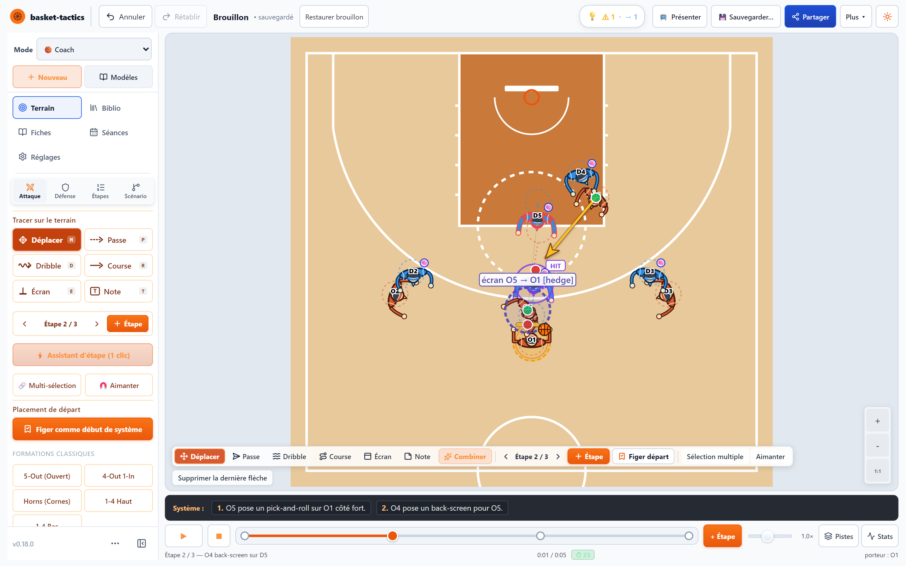
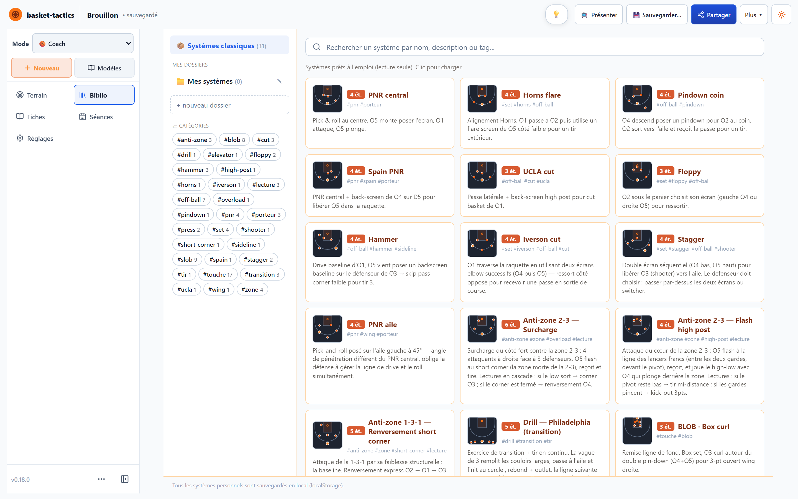
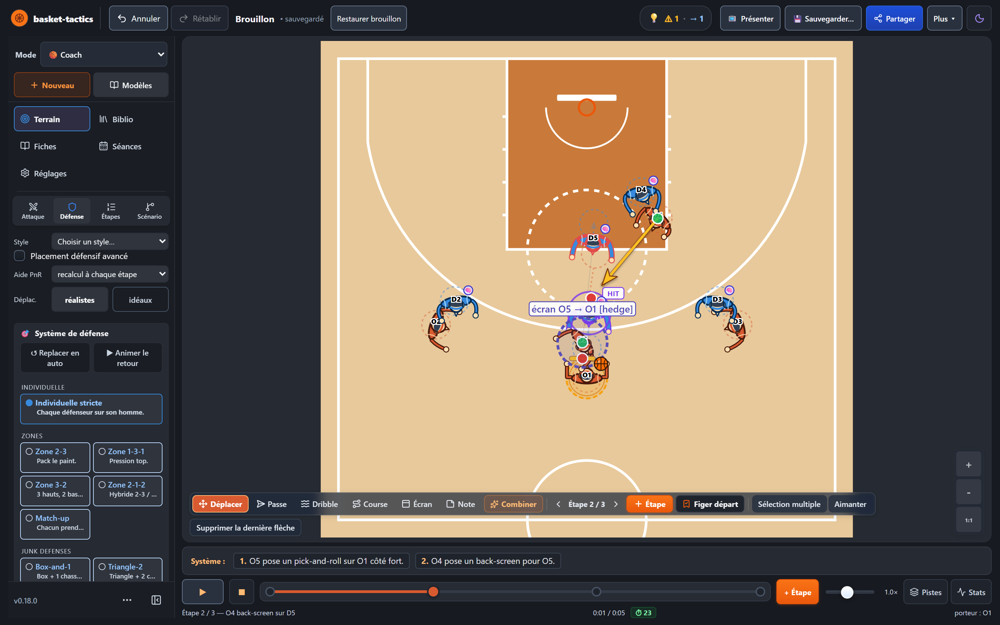
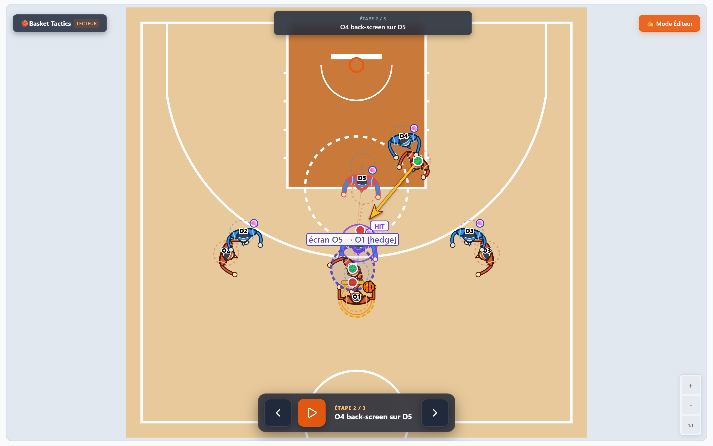
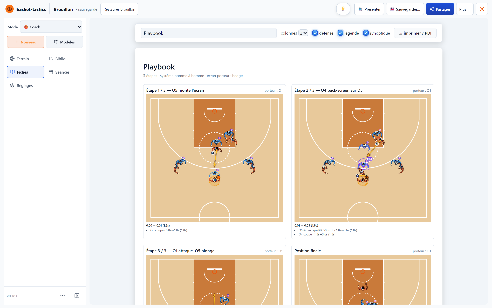
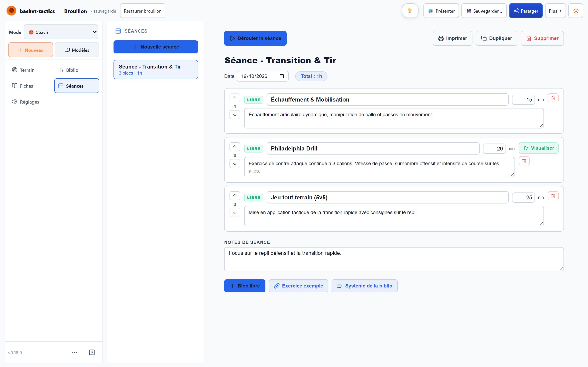

<div align="center">

# 🏀 Basket Tactics

**Le tableau tactique du coach de basket — avec une défense qui réagit vraiment.**

Dessine ton système en quelques gestes, regarde la défense se placer toute seule,
puis présente-le à tes joueurs, imprime la fiche et prépare ta séance.

[](https://basket-tactics.vercel.app/)


<br>

<a href="https://basket-tactics.vercel.app/"></a>

<sub>Spain PNR, étape 2 : O5 pose l'écran sur O1, O4 vient poser le back-screen sur D5 — la défense est calculée en direct.</sub>

</div>

---

## Pourquoi Basket Tactics ?

Un tableau blanc montre où vont **tes** joueurs. Basket Tactics montre aussi ce que fait **la défense** — et c'est là que se joue un système.

- **Pas de compte, pas d'installation, pas de tracking.** Tout tourne dans le navigateur, tes systèmes restent sur ton appareil.
- **Pensé pour le coach** : créer, expliquer et présenter un système en quelques minutes, sur ordinateur comme sur tablette.
- **Un vrai moteur tactique** derrière : homme à homme, zones, couvertures d'écran, aides et rotations calculées étape par étape.

---

## Fonctionnalités

<table>
<tr>
<td width="50%" valign="top">

### ✏️ Dessiner un système
Choisis une action (course, passe, dribble, écran, note), glisse depuis un joueur, puis **+ Étape** pour la suite. Formations de départ en un clic (5-Out, Horns, 1-4…), assistant d'étape, annuler / rétablir.

</td>
<td width="50%" valign="top">

### 📚 31 systèmes prêts à l'emploi
PNR central, Horns flare, Spain PNR, UCLA, Floppy, Hammer, Stagger, attaques de zone, 17 remises en jeu BLOB / SLOB… Recherche, tags et dossiers personnels.

</td>
</tr>
<tr>
<td colspan="2"></td>
</tr>
<tr>
<td width="50%" valign="top">

### 🛡️ Une défense entièrement paramétrable
Homme à homme, zones 2-3 / 1-3-1 / 3-2 / match-up, presse, box-and-1. Couvertures d'écran (hedge, switch, drop…), aides, rotations en cascade et repli en transition. Mode clair ou sombre.



</td>
<td width="50%" valign="top">

### 📺 Présenter à l'équipe
Mode lecteur plein terrain, étape par étape au clavier ou à la télécommande, avec la consigne de chaque étape bien visible.



</td>
</tr>
<tr>
<td width="50%" valign="top">

### 🖨️ Fiches systèmes
Playbook imprimable (PDF via le navigateur) : toutes les étapes, la défense, la légende et le minutage.



</td>
<td width="50%" valign="top">

### 🗓️ Séances d'entraînement
Blocs chronométrés (systèmes, exercices, blocs libres), fiche imprimable, puis déroulé guidé avec minuteur.



</td>
</tr>
</table>

**Et aussi** : partage par lien ou par code (`BT1`, `BTA1`, `BTG1`), export GIF / WebM / JSON, enregistrement des gestes en direct (jusqu'à 60 s), édition au doigt sur tablette, métriques en mètres et secondes, lignes de passe et champs de vision (niveau « Analyse »), match simulé (niveau « Développement »).

---

## Sous le capot

- **Moteur pur** — `src/lib/logic/` ne dépend ni de React ni du DOM : on lui passe l'état, il rend les positions calculées. Chaque réglage recalcule instantanément toutes les étapes.
- **Physique réaliste** — vitesses en m/s, départs progressifs, freinages, contournement des écrans par trajectoire courbe.
- **Aucune superposition de joueurs** — toutes les paires gardent un espacement minimal, garanti par des tests d'invariants ([détails](docs/PLAYER-CLEARANCE.md)).
- **SVG natif** — vectoriel, net à toutes les tailles et à l'export, sans Canvas ni librairie graphique.
- **Testé** — moteur, transformations d'état, hooks et composants couverts par Vitest.

| Stack | |
|---|---|
| Framework | Next.js 14 (App Router), application 100 % client |
| Langage | React 18, TypeScript strict |
| Rendu | SVG natif |
| Persistance | `localStorage` (aucun serveur) |
| Tests | Vitest + Testing Library |

<details>
<summary><b>Architecture</b></summary>

```
src/
├── app/                    # Next.js App Router (page.tsx)
├── components/             # CourtView, StepsPanel, DefensePanel, Timeline,
│                           #   PlaybookView, SessionsView, sidebar/, court/…
├── hooks/                  # useAppState (état + historique), lecture, bibliothèque
└── lib/
    ├── data/               # modèles (systèmes, remises en jeu, anti-zone,
    │                       #   exercices), séances, bibliothèque, terrain
    ├── logic/              # MOTEUR PUR — défense, écrans, lecture (playback/),
    │                       #   match/, numérotation des étapes
    ├── state/transforms/   # transformations pures de l'état
    └── types/              # types stricts
```

</details>

<details>
<summary><b>Documentation technique</b></summary>

| Fichier | Sujet |
|---------|-------|
| [`docs/architecture.md`](docs/architecture.md) | Stack, structure des dossiers, flux de données |
| [`docs/data-model.md`](docs/data-model.md) | Forme de l'`AppState`, types, persistance |
| [`docs/concepts-basket.md`](docs/concepts-basket.md) | Vocabulaire basket modélisé |
| [`docs/GAME-ENGINE.md`](docs/GAME-ENGINE.md) | Cartographie complète du moteur |
| [`docs/physics.md`](docs/physics.md) | Constantes physiques en mètres réels |
| [`docs/logique-defensive.md`](docs/logique-defensive.md) | Pipeline défensif étape par étape |
| [`docs/ui-design.md`](docs/ui-design.md) | Choix visuels et conventions de tracé |
| [`docs/menu-reference.md`](docs/menu-reference.md) | Référence de chaque réglage de l'interface |
| [`docs/SITUATION-CODE.md`](docs/SITUATION-CODE.md) | Codes de situation, animations et gestes |
| [`docs/keyboard-shortcuts.md`](docs/keyboard-shortcuts.md) | Raccourcis clavier |
| [`docs/testing.md`](docs/testing.md) | Stack de tests et conventions |

Historique des évolutions : [`CHANGELOG.md`](CHANGELOG.md).

</details>

---

## Retours

Projet personnel en développement actif. Une idée, un bug, un système qui se comporte bizarrement ? Ouvre une [issue](https://github.com/simongrossi/basket-tactics/issues) — tous les retours de coachs sont les bienvenus.

---

## Licence

© 2026 Simon Grossi — **Tous droits réservés.**

Le code source est consultable publiquement, mais **aucune copie, modification, redistribution ni réutilisation** n'est autorisée sans accord écrit préalable. Voir [`LICENSE`](LICENSE). Pour toute demande : simon.grossi@gmail.com.
